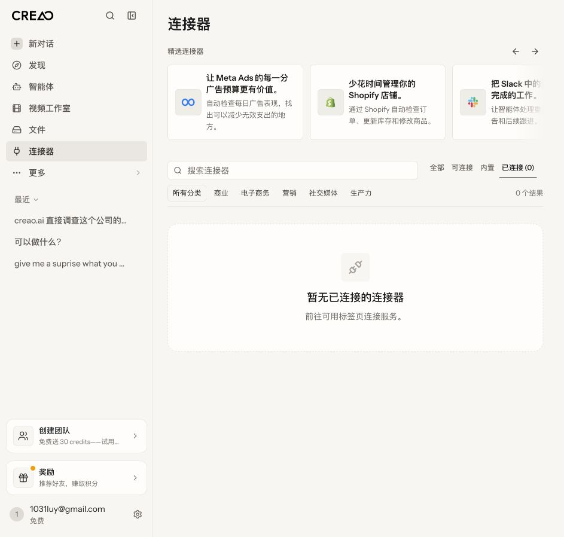
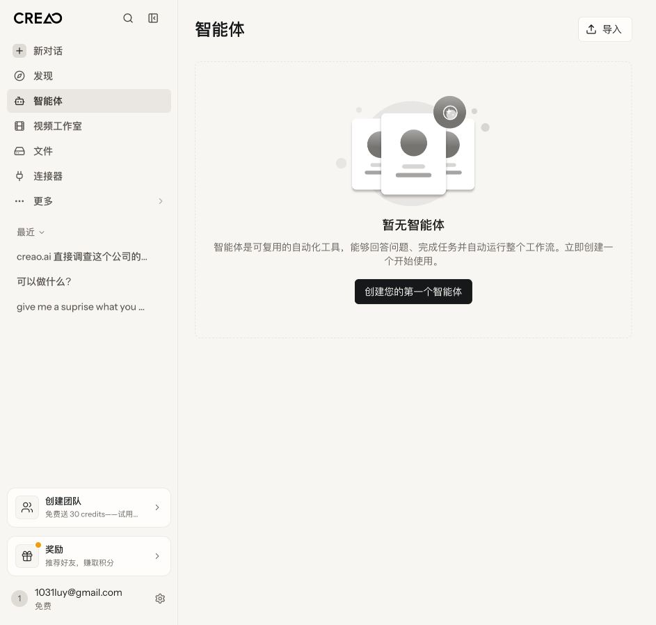

# CREAO Brief Interpretation and Execution Plan

> Initial exploration on 2026-10-11. This is working analysis, not the final `design-system-guideline.md` or `compliance-audit.md`. Rule examples are proposed rules and do not mean CREAO already has these rules.

## 1. What the brief actually asks for

The brief asks for a traceable chain: **existing design system → page composition rules → execution constraints for engineers and coding agents → pre-release checks → proof on real UI that the checks catch problems.**

Two different problems must be solved at once:

1. **Uncontrolled component usage:** Components and tokens exist, but developers build look-alike controls, pick unsuitable variants, or ignore interaction conventions. Reuse boundaries and checks are needed.
2. **Missing page composition:** A compliant button does not make a page sensible. Page types, information order, action placement, scroll regions, states, and responsive behavior need to be defined.

The brief explicitly asks for only two Markdown files. Check specifications, example assertions, PR templates, and the exception process can be written into the documents; building a new app or rewriting the component library is not required. Real CI integration can be follow-up engineering work, but the submitted mechanism must be concrete enough to implement, not just "have a designer review it" or "let AI check it".

## 2. Confirmed materials and gaps

| Material | Current status | Impact on delivery |
| --- | --- | --- |
| English brief | Saved as `task.md` | Basis for delivery scope |
| Chinese brief | Saved as a separate translation file (removed from the English-only submission; `task.md` is the original) | Faithful translation, kept separate from this document's recommendations |
| Live product | Entered via an existing logged-in session; browsed four pages, five states | Provides a set of current first-hand evidence |
| "Provided screens" mentioned in the brief | No separate attachment | Our own screenshots must not be called screenshots provided by the brief's authors |
| Upcoming feature brief | Not yet provided | General patterns can be designed, but layout fit for the new feature cannot be claimed as validated |
| Existing tokens / component library / Storybook / source | Not provided | Must not invent official component names, import paths, spacing, or breakpoint tokens |

Rendered CSS in the browser can help measure the UI, but cannot by itself prove the official component library's API, component provenance, or design intent. Other projects in the current working directory cannot stand in for CREAO source code.

## 3. Exploration performed in this round

Visited on 2026-10-11, UI language Chinese, screenshot size 943 × 898. The product initially showed a blank `/chat`, which recovered after one reload; the brief blank was not attributed to a product defect. Only page navigation and tab switching were performed; no agents were created, no tasks run, no external services connected, and no existing data modified.

| Step | Page / state | Current assessment | Evidence |
| --- | --- | --- | --- |
| 1 | `/chat` chat home | Main input area is clear; includes capability suggestions, popular agents, and a promo area; a suitable starting point for the chat workbench pattern. Real send and run not tested | [Screenshot 01](research/screenshots/01-chat.png) |
| 2 | `/apps` empty agents list | Has page title, explanation, and a clear create button; usable as a positive empty-state example | [Screenshot 02](research/screenshots/02-agents-empty.png) |
| 3 | `/files` file list | Has search, filters, view toggle, upload, and per-item actions; page-title semantics have a verifiable gap | [Screenshot 03](research/screenshots/03-files.png), [DOM](research/files-dom.json) |
| 4 | `/integrations` all connectors | Has a recommended area, search, tabs, categories, and result count; useful for studying information order on collection pages | [Screenshot 04](research/screenshots/04-connectors.png) |
| 5 | `/integrations` connected, empty | Empty-state copy does not match the real tab name, and the empty state has no direct next-step action | [Screenshot 05](research/screenshots/05-connectors-empty.png), [Accessibility tree](research/connectors-empty-ax.txt) |

### Key evidence: connected empty state

### Comparison evidence: agents empty state

Screenshots and accessibility trees include sidebar information from an existing account and are currently kept only as local working material. For external submission, retake them with a test account or produce clearly labeled redacted copies, keeping the original evidence and processing notes.

## 4. Three preliminary instances for the final audit

These demonstrate "observed fact + proposed rule"; they do not claim the repository CI was run, nor that they violate an official design system we have not obtained.

### F-01: Files page lacks a semantic page heading

- **Fact:** The "Files" label at the top of `/files` is a `BUTTON` in the DOM, and the page has no `h1`, `h2`, `h3`, or `[role="heading"]`. The accessibility tree also exposes it as a button. By contrast, `/apps` and `/integrations` both have a level-one page heading.
- **Proposed rule `LAY-01`:** Every top-level management page must have one level-one heading in the main content area whose accessible name matches the page identity. Breadcrumbs or back buttons cannot replace it.
- **Impact:** Users who navigate by headings cannot locate the file management area via a page heading; similar visual appearance hides the structural difference.
- **Check:** On a stably loaded page, assert the main region has exactly one visible level-one heading named "Files"; a screenshot diff alone is not enough.
- **Fix direction:** Keep the root-directory navigation button if it has a real purpose, and add a level-one heading with the existing typography component; if it has no navigation purpose, render it directly as a heading component. Check the existing component library before choosing the implementation.
- **Boundary:** This is a structural issue under a proposed product standard; it cannot by itself support a WCAG conformance verdict.

### F-02: Empty state points to a tab name that does not exist

- **Fact:** Under "Connected (0)" the hint reads "Go to the Available tab to connect services." (zh UI copy), while the actual tabs are "All / Connectable / Built-in / Connected (0)" (zh UI labels); there is no "Available".
- **Proposed rule `NAV-02`:** In-product destinations mentioned in guidance copy must match the navigation names actually visible in the current language, and the destination must exist.
- **Impact:** Users must infer on their own that "Available" means "Connectable".
- **Check:** Use a single localization entry for a single navigation name; a functional test compares the empty state's destination copy with the actual tab name and verifies that selecting it leads to the connectable results. Only checking "the translation key exists" is not enough to find this.
- **Fix direction:** Reuse the localized name of the "Connectable" tab; ideally provide a direct "Browse connectable services" action.

### F-03: Recoverable empty state lacks an in-place action

- **Fact:** The agents empty state offers a "Create your first agent" button (zh UI label); the connected empty state contains only an explanation, with no link or button, so users must look for the tab above.
- **Proposed rule `STATE-01`:** When an empty state has a user-actionable recovery step, the empty-state region must provide an actionable control leading to that step; just saying "go somewhere" is not enough. Purely informational states and no-permission states should be defined separately.
- **Impact:** Next steps are expressed inconsistently across similar empty states, increasing search cost.
- **Check:** Prepare a zero-connector data fixture for this state, locate the empty-state region, check the recovery action is visible and enabled, and click to verify the target state. Do not use "a button exists anywhere on the page" as the pass condition.
- **Fix direction:** Reuse the existing Button or Link inside the empty state to switch to the "Connectable" tab while keeping reasonable search conditions.
- **Boundary:** Usable navigation exists above, so this is not a dead end; it is a consistency and efficiency issue under a proposed pattern, lower in severity than blocking a core task.

### Things not to over-infer

- The Files view toggle appears as a checkbox in the accessibility tree, but in the DOM it is a button with `aria-pressed`; one label in the tree cannot establish a component implementation error. Not listed as a violation.
- Different widths, button counts, or cards across pages are not necessarily problems; first determine whether they serve the same task and belong to the same pattern.
- Screenshots cannot prove use of the wrong token, wrong component import, or an unsuitable source API.
- Color contrast, keyboard focus order, narrow screens, zoom, real runs, failure recovery, approvals, and scheduled-task flows have not been measured; none of these can be written as pass or fail.

## 5. Official materials that inform scope

The official [Agents product page](https://creao.ai/features/ai-agents) describes turning a successful chat into a reusable Agent; the [Agents docs](https://docs.creao.ai/features/agents) cover structured inputs, the detail page, files, sessions, versions, and approvals. [Scheduled Runs](https://creao.ai/features/scheduled-runs) covers frequency, time zone, next run, and run history. [Dynamic Workflows](https://creao.ai/features/dynamic-workflows) describes plan approval, execution status, and per-task inspection.

These materials are enough to help decide which patterns are needed, but do not mean we personally operated those screens in this round. The official product page and developer docs also describe the autonomy mode default differently; the current account shows "Always ask" (zh UI label), which cannot establish the default for all new accounts. The final standard should require the current mode to be clearly displayed, rather than stating an unconfirmed default as fact.

## 6. Recommended page patterns

Start with a small number of highly reusable patterns covering the main flows, so each feature does not invent its own template. All of the following are proposals; actual component names must be mapped once the existing library is available.

| Pattern | When to use | Structure and behavior that must be defined |
| --- | --- | --- |
| `P-01 Conversation Workspace` | Chat, running tasks | Global nav → conversation identity and status → messages and execution results → input area; how the artifact inspection panel expands, scrolls, and returns to the conversation; where approval cards sit in the flow |
| `P-02 Collection` | Agents, files, connector collections | Page identity → page-level actions → search/filter/result count → list or cards → empty, loading, error states; whether recommended content may occupy the main management area |
| `P-03 Resource Detail` | A single Agent or a single run | Name, status, and context → primary actions → stable tab navigation → current content; run status and configuration status must be distinct |
| `P-04 Focused Configuration` | Create Agent, configure scheduled task | Short completable tasks use a dialog; tasks needing long forms, cross-area reference, or a shareable URL use a full page; define field grouping, errors, save, and cancel |
| `P-05 Review and Approval` | Approving a plan or external action | What will happen, affected objects, content preview, current status, approve and reject; after the action, show the real result clearly; "submitted" must not be treated as "completed" |

Choose a pattern by task: advancing a task mainly in conversation → P-01; browsing and filtering similar objects → P-02; inspecting a single object → P-03; completing a configuration with a clear end → P-04; confirming consequences → P-05. Approval cards can be embedded in a conversation or detail page and need not become a standalone page.

Each pattern must spell out: required and optional regions, mapping to existing components, action hierarchy, scroll ownership, narrow-screen collapse order, long-text handling, a full state table, exception conditions, and check methods. Do not arbitrarily mandate "only one primary button per page": when cards on a collection page each have their own actions, hierarchy should be defined by action region and task.

## 7. What makes the enforcement mechanism concrete

### Rule format

Each rule uses a stable ID and includes: scope, MUST/SHOULD, observable requirement, rationale, pass/fail examples, checker, failure condition, severity, and exception path.

For example, acceptance for `LAY-01` should be "the main region of a top-level management page has exactly one visible level-one heading with a matching name", not "the page hierarchy is clear".

### Three kinds of checks, each for a class of problems

| Check layer | What it can prove | What it cannot prove alone |
| --- | --- | --- |
| Source checks | Component imports come from the approved library; constrained color/spacing uses approved tokens; no re-creation of basic controls that already exist | That the page is usable, the layout sensible, or actions actually succeed |
| Runtime tests | Headings, names, focus, state transitions, empty-state recovery, content not obscured; screenshot regression with fixed data | Which source component was used; whether a new layout should become standard |
| Human review with explicit checklist items | Whether pattern choice, information priority, density, edge cases, and rule exceptions are reasonable | Replacing automated tests or validating flows that were not executed |

AST checks are more reliable than plain string search: they must handle aliases, re-exports, wrapper components, and dynamic styles. Visual regression detects change, but the baseline screenshot itself may be non-compliant, so the baseline must be reviewed first. Automated accessibility tools are only a supplement; they do not automatically validate all product rules.

### Release gate

The final standard should state a contract like the following:

1. The PR lists affected pages, pattern IDs, component library version, rule version, and state matrix.
2. The author or coding agent first reads the standard and existing component mapping, then implements the page; it must not create nonexistent tokens or assume component APIs.
3. Automated check results for affected paths must be submitted, along with screenshots at fixed viewport, fixed data, and fixed state. The final viewports should follow the product's support range; the current 943 × 898 is only the exploration environment, not the formal coverage matrix.
4. A blocking MUST failure, a required check not run, or missing evidence means no pass. Results distinguish PASS, FAIL, NOT TESTED, and EXCEPTION with an approval record.
5. Designers own pattern and experience judgments; engineering leads own check implementation and execution records. Exceptions must include rule ID, applicable path, reason, mitigation, owner, and expiry date. Coding agents cannot approve their own exceptions.
6. Legacy page debt is tracked separately; new and modified areas follow the new rules, issues blocking critical tasks are prioritized, and a site-wide overhaul is not crammed into one feature PR.

Until the repository is available, the above is only an implementable mechanism design and must not be written as "branch protection/CI already enabled". Do not invent test commands that do not exist in the project.

### Must prove the checks do not misjudge

At minimum, use one real violation as a negative case and one compliant screen as a positive case. For STATE-01: the connectors empty state should fail, the agents empty state should pass; then verify on the fixed empty state that clicking reaches the target. Catching a negative case does not prove the whole system works, but it shows the rule is more than a slogan.

## 8. Recommended structure for the two formal deliverables

### `design-system-guideline.md`

1. Scope, authoritative sources, reuse boundaries of the existing design system.
2. Page pattern selection table.
3. Region, behavior, state, and responsive contracts for each pattern.
4. Numbered rule catalog and component mapping.
5. Execution steps for coding agents and the PR evidence template.
6. Check mechanism, blocking criteria, owners, and exception process.

### `compliance-audit.md`

1. Audit inventory, access time, language, viewport, states, and uncovered items.
2. Each finding: screenshot location, observed fact, impact, rule ID, severity, fix.
3. Each finding's check entry point, input state, failing assertion, and expected output.
4. Clearly separate executed checks from designed-only checks; include positive cases, unconfirmed items, and post-fix re-verification requirements.

The two files cross-reference by rule ID. If only two files can be submitted, include necessary visual evidence via accessible links or a format the submission platform supports; do not deliver absolute paths that only work on this machine, and do not assume an extra screenshot directory is allowed.

## 9. Recommended order of work

1. **Fill in materials first.** Confirm whether separately provided screenshots, a feature brief, and an accessible component library or tokens doc exist. The feature brief matters most, as it determines the stress test for new layouts.
2. **Complete the page inventory.** Where authorized and without triggering real tasks, observe detail, configuration, approval, and run states; states that cannot be reached are referenced via clearly labeled materials and must not be disguised as first-hand testing.
3. **Write executable v1 rules.** Start with 4–5 patterns and a set of high-value rules, avoiding many uncheckable principles.
4. **Do a real audit.** First connect the three instances from this round, then add component-reuse and layout evidence; do not infer nonexistent violations to pad the count.
5. **Validate generalization with the new feature.** Map the feature brief item by item to patterns, showing how new regions, states, and exceptions are decided. Without a real brief, a substitute case can only be labeled as a hypothetical exercise.
6. **Check submission completeness.** Every finding has a rule and check method; every blocking rule has an owner; all sources, run statuses, and limitations are accurate; IDs are consistent across the two final files.

Completed so far: translation, initial product exploration, and the solution plan. The formal standard, full compliance audit, component library mapping, and CI integration are not yet done.
